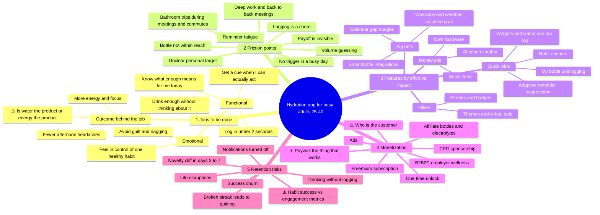

# Discovery Sprint Brainstorm: Mobile Water-Tracking App

> **Target user:** Busy adults aged 25–40 who *know* they should drink more water but forget.
> **Purpose:** A structured starting point for the discovery sprint. Every item here is a hypothesis to validate, not a decision.
> **Legend:** ⚠️ = a real strategic tension the team should debate before committing.

---

## 1. Mindmap (overview)



---

## 2. Core user jobs to be done

**Main job:** *"When I'm heads-down in a busy day, help me drink enough water without having to remember or think about it, so I feel more energetic and less run-down."*

| Type | Job statement | Signal to look for in interviews |
|---|---|---|
| Functional | Help me drink enough without relying on memory | Workarounds like a bottle on the desk, rubber bands on the bottle, or phone alarms |
| Functional | Tell me what "enough" means for *me* today (workouts, heat, coffee) | Confusion about "8 glasses" or a goal they guessed |
| Functional | Cue me when I can actually act on it, not in the middle of a meeting | Reminders dismissed in meetings or while commuting |
| Functional | Make tracking take almost no effort, or none | Apps abandoned because logging was tedious |
| Emotional | Let me feel I'm handling one health basic, given everything else I'm not | "At least I'm doing *this*" language |
| Emotional | Don't make me feel guilty or nagged | Words like "annoying," "nagging," or "I muted it" |
| Social (weak) | Hold me accountable with a partner or coworker *(may not matter)* | Shared bottles or office water challenges |
| Outcome | More energy and focus, fewer headaches, maybe skin or weight goals | What they say they *hope* hydration will fix |

> ⚠️ **TENSION A: Is the product water, or what water does for them (energy and focus)?**
> - **Stay narrow (water):** a clear promise, easy to explain, quick to build. The risk is that it's a commodity category with a low ceiling and low willingness to pay.
> - **Go broader (energy and wellbeing):** a bigger market, more ways to charge, and value users can feel. The risk is a vague promise, competing with full wellness platforms, and the core habit loop getting lost.
> - **Proposed resolution to test:** keep water as the habit loop, but show results in terms of energy (for example, a 1-tap energy check-in tied to hydration days). Then check whether users actually care about that link.

---

## 3. Friction points in current behavior

Ordered by how strongly we expect each one to drive the problem. Validate the order in interviews and diary studies.

1. **No reliable trigger.** Thirst cues are weak, and busy people override them. Drinking isn't tied to an existing routine.
2. **Flow states and back-to-back meetings.** The windows when someone *could* drink are short and unpredictable.
3. **Logging is a chore.** Opening an app, picking a cup size, and confirming is too many steps, so people drink without logging and the data falls apart.
4. **Volume guessing.** "Was that 300 or 500 ml?" Being made to be precise makes people avoid logging.
5. **Bottle isn't nearby.** Water access depends on the setting: the commute, the office kitchen, or the car.
6. **Unclear personal target.** Generic goals feel random, so people don't trust or commit to them.
7. **Payoff is invisible.** Being under-hydrated doesn't feel urgent, and drinking more gives no quick reward.
8. **Bathroom trips.** A real reason to avoid drinking before meetings, commutes, or workouts. It's rarely mentioned but probably matters.
9. **Reminder fatigue.** Fixed hourly reminders get ignored, then muted, then the app gets deleted.
10. **Unclear rules for other drinks.** Does coffee, tea, sparkling water, or water-rich food count? Uncertainty makes the numbers feel less trustworthy.

---

## 4. Feature ideas ranked by effort vs. impact

Effort: **S** = under 1 sprint, **M** = 1–3 sprints, **L** = more than a quarter or needs partners/hardware. Impact is scored 1–5 against retained users hitting their goal. Confidence shows how much the score depends on assumptions we haven't tested.

### 4a. Priority ranking

| Rank | Feature | Effort | Impact | Confidence | Why |
|---|---|---|---|---|---|
| 1 | **One-tap logging** from home/lock-screen widgets, watch complications, and Live Activity | S | 5 | High | Fixes friction #3. Logging without opening the app is the minimum to compete |
| 2 | **"My bottle" units** (set your bottle once; tap = ½ or 1 bottle) | S | 4 | High | Fixes #4. Matches how people actually drink |
| 3 | **Adaptive reminders**: skip if they logged recently, learn which times get ignored, quiet hours, a daily cap | M | 5 | Med | Fixes #9. The main protection against notifications being turned off |
| 4 | **Habit anchors** ("after my first coffee," "after standup," "when I get to the office") | S | 4 | Med | Fixes #1. Linking to an existing routine is a well-known way to build habits |
| 5 | **Calendar-aware nudges** (in gaps between meetings; a heads-up before long meetings) | M | 4 | Low–Med | Fixes #2 and #8. Needs calendar permission, which raises the trust bar |
| 6 | **Personalized, changing goal** (weight, workouts from Health/Fit, local weather) | M | 3 | Med | Fixes #6. Credibility matters more than precision |
| 7 | **Forgiving end-of-day recap** ("About how much did you drink today?") | S | 3 | Med | Fills gaps when people drink but don't log; protects data and morale |
| 8 | **Energy check-in plus simple patterns** ("You report more energy on days you hit 2 L") | M | 3 | Low | Fixes #7 by making the payoff visible. Tests Tension A |
| 9 | Voice logging through Siri or Google Assistant | S | 2 | Med | Useful hands-free, but a niche use |
| 10 | Accountability buddy (one partner, not a feed) | M | 2 | Low | Could help retention for some users; test before building |
| 11 | Smart-bottle integration with existing third-party bottles | M–L | 3 | Low | Logging without any effort, but it's a small hardware-owner niche |
| 12 | Photo or computer-vision logging | M | 1 | Low | Adds steps for something we want to take *fewer* steps |

### 4b. Effort/impact quadrants

```
             HIGH IMPACT
                 │
  Quick wins     │   Big bets
  • Widgets/watch│   • Adaptive reminders
  • Bottle units │   • Calendar-aware nudges
  • Habit anchors│   • Dynamic goal
  • EOD recap    │   • Energy patterns
LOW ─────────────┼───────────────── HIGH EFFORT
  Fillers        │   Money pits (avoid for now)
  • Streaks      │   • Building own smart bottle
  • Badges/themes│   • Social feed / challenges
  • Voice log    │   • Conversational AI coach
  • Virtual pet  │   • Photo/CV logging
                 │
             LOW IMPACT
```

> ⚠️ **TENSION B: How strong should the gamification be?** Streaks, pets, and badges help early engagement, and some competitors in this category lean hard on them. For a health-tech brand aimed at professionals aged 25–40, though, they can feel childish and make people feel guilty when a streak breaks (see Retention R3). Choose a position on purpose: **playful** or **calm and credible**. Doing a bit of both usually ends up weak at each.

> ⚠️ **TENSION C: Should we ask for more permissions to get smarter?** Calendar, Health, and location data make nudges much better, but each permission request loses some users during onboarding and raises privacy expectations. Recommendation: start with zero permissions, and ask for calendar or Health access only after the user has had a first success.

---

## 5. Monetization paths and tradeoffs

| Path | How it works | Pros | Cons / risks | Fit |
|---|---|---|---|---|
| **Freemium subscription** | Free core; Premium adds adaptive and calendar nudges, insights, and integrations | Recurring revenue; standard for the category | Hydration alone has low willingness to pay; free alternatives exist; risks walling off the features that drive retention | Medium |
| **One-time "Pro" unlock** | One payment for everything | Simple and honest; suits low willingness to pay; good reviews | No recurring revenue; hard to fund ongoing smart features | Medium (good as an early test) |
| **B2B2C employer wellness** | Sold to employers or wellness platforms as a benefit | Bigger contracts; the target demographic *is* the workforce; free to the user | Long sales cycles; buyers want reporting and dashboards; more data-privacy and compliance work; the roadmap starts serving the buyer, not the user | High potential, high distraction |
| **Affiliate commerce** | Commission on bottles, filters, electrolytes | Fits the behavior; low effort | Small revenue; can feel salesy; hurts credibility if recommendations look paid | Low (add-on only) |
| **CPG / brand sponsorship** | Beverage or electrolyte brands sponsor goals or challenges | Potentially large deals | Clear conflict of interest for a health brand; risky for user trust | Low |
| **In-app ads** | Display or rewarded ads in the free tier | Monetizes free users | Adds friction to a product meant to have none; low CPMs; cheapens the brand | Avoid |
| **Wellness expansion** | Hydration as the entry point into sleep, energy, and movement habits | Raises the ceiling on willingness to pay and lifetime value | Scope creep; competes with established platforms (ties to Tension A) | Long-term option |

> ⚠️ **TENSION D: What goes behind the paywall?** The features that make the app *work* (adaptive and calendar-aware nudges) are the ones people would pay for. But putting them behind the paywall means free users get the dumb reminders that cause churn and bad reviews. Options:
> 1. Keep the smart core free and charge for insights and integrations. Risk: nobody pays for "nice to have."
> 2. Charge for the smart core. Risk: free retention suffers, so fewer people reach the point of upgrading.
> 3. A time-limited trial of the full experience, then step down. Risk: users feel something was taken away.
>
> **Test in the sprint:** willingness-to-pay interviews (Van Westendorp pricing or a fake-door paywall) that show *which* feature people mention when they say they'd pay.

> ⚠️ **TENSION E: Who is the customer, the individual or the employer?** This decides the roadmap, the metrics, and how we talk about data. Decide before the B2B pipeline starts pulling the product in a different direction.

---

## 6. Retention risks and mitigations

| # | Risk | When | Mitigation |
|---|---|---|---|
| R1 | **Novelty cliff**: interest drops once setup is done | Days 3–7 | Onboarding focused on *one* habit anchor plus one early win; a Day-3 "here's what you did" moment |
| R2 | **Notifications turned off** (once the OS permission is gone, the product loses its main way to reach the user) | Weeks 1–3 | Ask for notification permission *after* the first value moment; adaptive frequency with a daily cap; widget and watch as fallback channels; check the opt-out rate weekly |
| R3 | **Broken streak leads to quitting** ("I already blew it") | Any time | Weekly targets instead of strict daily streaks; streak freezes; non-judgmental copy |
| R4 | **Drinking without logging**: the data says "failing" when the user isn't, so they feel guilty and leave | Weeks 2–6 | End-of-day estimate; bottle units; frame data as "approximately"; never shame |
| R5 | **Invisible value**: "I don't feel different" | Month 1–2 | Energy check-ins and simple patterns; reflect what the user reports back to them |
| R6 | **Life disruptions** (travel, illness, weekends, a new job) | Any time | Context modes (Travel, Sick day, Weekend); recovery flows that welcome people back instead of resetting them to zero |
| R7 | **Success churn**: the habit sticks and the app no longer seems needed | Months 2–4 | See Tension F |
| R8 | **Boredom / no progression** | Month 2+ | Gradually reduce the scaffolding (fewer nudges as the habit forms); optional new goals |

> ⚠️ **TENSION F: Does success mean the habit sticks, or that they keep using the app?** If the app works, the user eventually doesn't need reminders, so churn may be partly a *success* signal. That conflicts with DAU-based thinking and with subscription economics. The team needs to pick:
> - **North-star metric:** "% of active weeks where the user hits their goal" (outcome) vs. DAU/MAU (engagement). These can move in opposite directions.
> - **Business model fit:** subscriptions fit poorly with a "graduate and leave" product; one-time purchase or B2B (where the employer pays for outcomes) fit better.
> - **Design implication:** a planned "maintenance mode" (light weekly check-ins) instead of fighting to keep daily opens.

---

## 7. Strategic tensions to debate

| ID | Tension | Why it matters | Who should weigh in |
|---|---|---|---|
| A | Water tracker vs. energy/wellness product | Sets the scope, competitors, and ceiling on willingness to pay | PM, founders, design |
| B | Playful/gamified vs. calm/credible tone | Brand position and guilt-driven churn | Design, marketing |
| C | Permission-rich smart nudges vs. a privacy-light start | Onboarding conversion vs. nudge quality | PM, eng, legal/privacy |
| D | Paywall placement (smart core vs. extras) | Conversion vs. free-tier retention | PM, growth, finance |
| E | B2C vs. B2B2C as the main customer | Roadmap ownership and data obligations | Founders, sales, legal |
| F | Habit-success metrics vs. engagement metrics | North star, business model, and design approach | Leadership |
| G | **Health and safety boundaries** | A health-tech brand can't push "more is better" blindly. Some users (for example, those with kidney or heart conditions, or on fluid restrictions) need different guidance, and over-hydration is a real if rare risk. Health claims carry regulatory exposure | PM, clinical advisor, legal |

---

## 8. Riskiest assumptions to test this sprint

| Assumption | Fastest test |
|---|---|
| Forgetting, not motivation, is the main barrier | 8–10 interviews plus a 5-day diary study (log every "missed" drinking moment and why) |
| Users will keep notifications on if they're adaptive | Prototype test with a dismissal log; compare with how people describe the reminders they used before |
| Users will grant calendar access for better timing | Fake-door permission prompt in a clickable prototype; measure the opt-in rate |
| Energy is a more compelling result than "ml drunk" | A/B test two landing-page or onboarding value propositions (water vs. energy) |
| Users will pay for smart nudges | Fake-door paywall plus Van Westendorp pricing questions |
| Employers would buy this | 3–5 conversations with HR or benefits buyers (a quick check on Tension E) |

---

*All feature, market, and competitor assumptions here are hypotheses to validate in discovery. Have a person review this before using it in planning or external material.*
