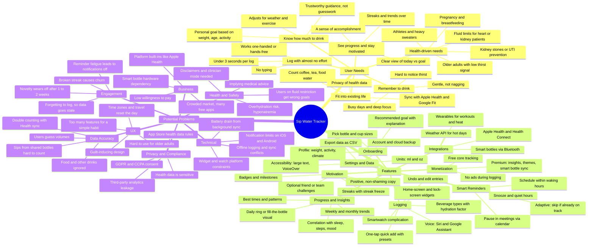

# Mindmap: Daily Water Intake Tracker (Mobile App)

> Working title: **Sip**. A mobile app that helps people build and keep a healthy daily hydration habit.
> This mindmap covers three areas: **user needs**, **features**, and **potential problems**. Read the needs first, because every feature should trace back to one.

---

## How the branches connect

| User need | Features that serve it | Problem to watch |
|---|---|---|
| Know how much to drink | Personalized goal, weather and workout adjustments | Wrong goals for people on fluid restriction; overhydration |
| Remember to drink | Adaptive reminders, calendar-aware pause, quiet hours | Reminder fatigue, so users turn notifications off |
| Log with almost no effort | Quick-add presets, widgets, watch, voice, smart bottle | Guessed volumes and double counting reduce accuracy |
| See progress and stay motivated | Daily ring, streaks, trends, badges | Novelty wears off; a broken streak can cause churn |
| Health-driven needs | Health profiles, clinician-set goals, export | Implying medical advice; regulatory exposure |
| Fit into existing life | Health app sync, beverage types, privacy controls | Sensitive health data; sync conflicts |

## Key assumptions to test first

1. **Logging friction is the main reason people stop.** Test: compare 7-day retention for widget-first logging against in-app-only logging.
2. **Adaptive reminders beat fixed-interval reminders.** Test: A/B test the notification opt-out rate and the number of days users hit their goal.
3. **Streaks help more than they hurt.** Test: compare churn after a broken streak with and without a "streak freeze."
4. **Users will pay for insights or smart-bottle sync.** Test: put a fake-door premium screen in front of users and measure the tap-through rate.

## Suggested MVP cut

- **In:** onboarding with a personalized goal, one-tap logging, a home-screen widget, adaptive reminders, the daily ring and a 7-day trend, Apple Health and Health Connect sync, and a basic streak.
- **Later:** beverage hydration factors, weather and workout adjustments, a watch app, badges, and challenges.
- **Not now:** smart-bottle hardware, social features, clinician mode. These need validated demand and a safety and regulatory review first.
